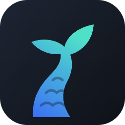
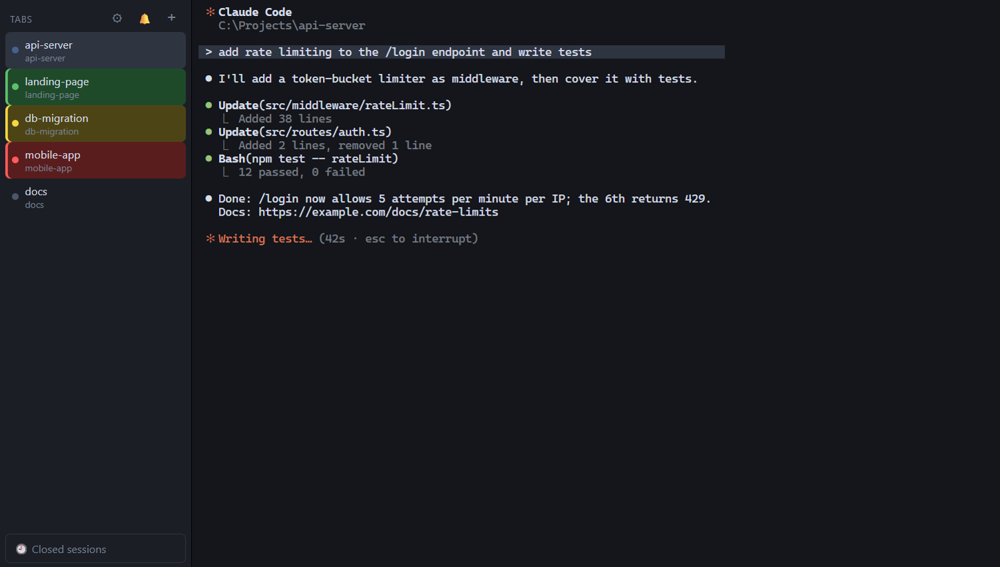
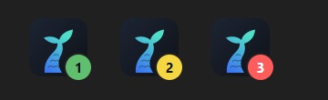
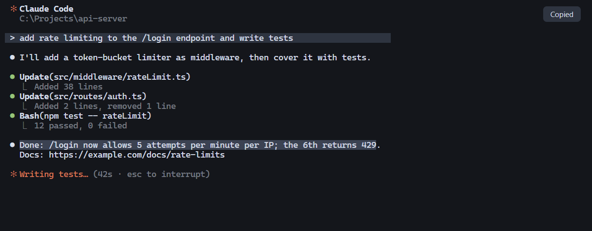
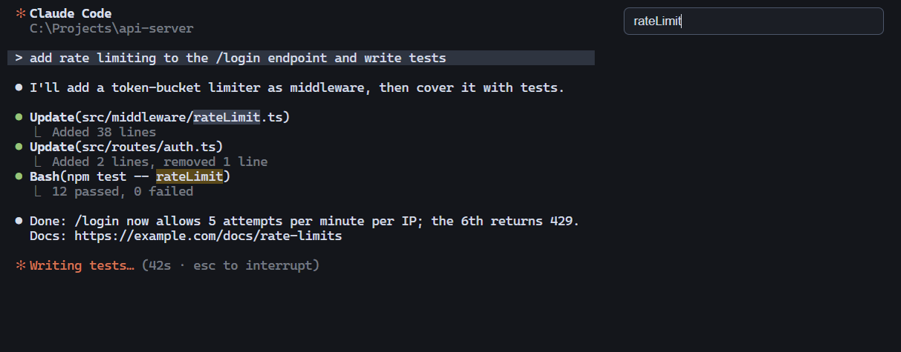
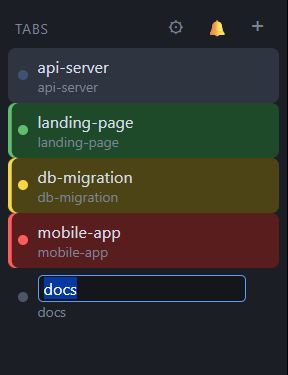
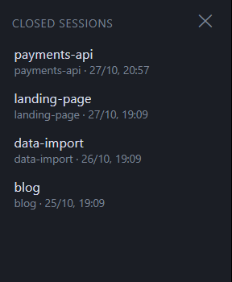
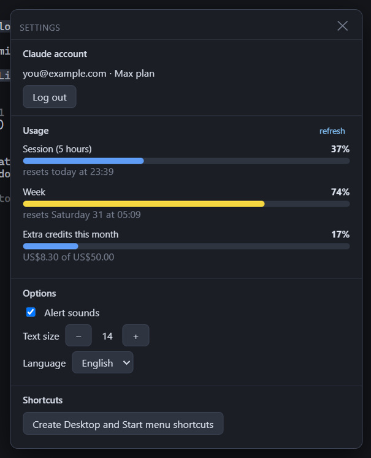

<p align="center">
  
</p>

<h1 align="center">Flukeshell</h1>

<p align="center">
  <b>A Windows terminal built for Claude Code.</b><br>
  Every session gets its own tab, and the tab lights up when Claude needs you.
</p>

<p align="center">
  
</p>

---

## Why

When you run several Claude Code sessions at once, it's easy to miss the one that finished ten minutes ago,
or the one stuck on a permission prompt. Flukeshell keeps every session in a **vertical tab** and tells you,
at a glance and with a sound, **which ones need you and why**.

## Contents

- [Features](#features)
  - [Tabs that tell you what Claude is doing](#tabs-that-tell-you-what-claude-is-doing)
  - [Sounds and notifications](#sounds-and-notifications)
  - [Taskbar badge](#taskbar-badge)
  - [Copy and paste like cmd](#copy-and-paste-like-cmd)
  - [Search the output](#search-the-output)
  - [Rename tabs](#rename-tabs)
  - [Sessions survive restarts](#sessions-survive-restarts)
  - [Closed sessions](#closed-sessions)
  - [No lost work](#no-lost-work)
  - [Settings: account, usage, options](#settings-account-usage-options)
  - [Links, paths and files](#links-paths-and-files)
- [Requirements](#requirements)
- [Install and run](#install-and-run)
- [Keyboard and mouse](#keyboard-and-mouse)
- [What it changes on your PC](#what-it-changes-on-your-pc)
- [Uninstall](#uninstall)
- [How it works](#how-it-works)
- [Development](#development)

---

## Features

### Tabs that tell you what Claude is doing

Each tab shows its **name** (Claude's own title, or one you choose) and its **folder**. The color tells you
the state of the Claude session inside it:

| Look | State | When |
|---|---|---|
| 🔵 pulsing dot | **Working** | you sent a prompt and Claude is on it |
| 🟩 green tile | **Done** | Claude finished its answer |
| 🟨 yellow tile | **Needs you** | Claude asks a question, needs a permission, or wants a plan approved |
| 🟥 red tile | **Problem** | API error (rate limit, overloaded server, expired login, billing…) or Claude quit unexpectedly |
| ⚪ grey dot | **Idle** | Claude is open and waiting for your next prompt |

The color stays until you type in that tab, so you can't miss it. Green also clears when you open the tab.

The states come from Claude Code itself, through its official
[hooks](https://code.claude.com/docs/en/hooks): no screen scraping, no guessing.

### Sounds and notifications

Every time a tab turns green, yellow or red Flukeshell plays a short **two-note sound**, a different one for
each state, so you can tell them apart without looking. Mute it with 🔔 at the top, or from Settings.

If you're looking at another tab or another app, you also get a **Windows notification**. Click it and
Flukeshell comes to the front **on the right tab**, even if it was minimized.

### Taskbar badge



The taskbar icon shows **how many tabs are waiting for you**, in the color of the most urgent one: red beats
yellow, yellow beats green.

### Copy and paste like cmd



- **Select with the mouse and it's already copied.** A small *Copied* message confirms it.
- **Right-click pastes.** Right-click on a selection copies it.
- **Ctrl+C** copies when there's a selection, and interrupts as usual when there isn't. **Ctrl+V** pastes.
- **Works inside full-screen Claude Code** too, which normally captures the mouse.
- **An image on the clipboard** (a screenshot, for example) goes straight to Claude with Ctrl+V or right-click.
- **Shift+Enter** inserts a new line in Claude's prompt instead of sending it.

### Search the output



**Ctrl+Shift+F** opens the search box. **Enter** jumps to the next match, **Shift+Enter** to the previous
one, **Esc** closes it. Every match is highlighted.

### Rename tabs



**Double-click a tab** and type a name: **Enter** saves it, **Esc** cancels it. Leave it empty to go back to
the automatic title. Names are kept across restarts.

### Sessions survive restarts

Close Flukeshell and open it again: every tab comes back in its folder, and each Claude session **resumes
its conversation** (`claude --resume`). Your tab names, text size and preferences are kept too.

### Closed sessions



Every Claude session that ends is saved in **🕘 Closed sessions**, at the bottom of the column: a tab you
closed, a session ended with `/exit`, or one that crashed. Each entry shows its name, folder, date and time.

- **Click** an entry to reopen it in a new tab, in its folder, with its whole conversation.
- **✕** removes it from the list.
- The last 100 are kept.

### No lost work

- **Closing a tab asks first.** If Claude is open in it, the message reminds you that you'll find the
  session under *Closed sessions*.
- **Closing the app while Claude is working** shows which sessions are still busy, and asks whether to close
  anyway.

### Settings: account, usage, options



Click **⚙** at the top.

- **Claude account**: shows who's logged in and the plan. **Log out** signs you out (it asks first);
  **Log in** opens a tab with Claude's login.
- **Usage**: the same numbers as Claude Code's `/usage` command:
  - **Session (5 hours)**: how much of the current 5-hour window you've used, and when it resets;
  - **Week**: your weekly limit, and when it resets;
  - **Extra credits this month**: spent and monthly cap, if extra usage is turned on.

  Bars turn yellow from 70% and red from 90%. Usage is shown only for Claude **Pro and Max** subscriptions.
- **Options**: alert sounds on/off, **text size** (also **Ctrl+mouse wheel**), and **language**
  (English or Italiano).
- **Shortcuts**: creates the Flukeshell shortcut on the **Desktop** and in the **Start menu**.

### Links, paths and files

- **Ctrl+click** a link to open it in the browser.
- **Ctrl+click** a file path (`src/app.ts`, `C:\logs\out.txt`): it opens with its default app. Paths with a
  line number (`src/app.ts:42`) open at that line in Notepad++, if you have it.
- **Drag files** from Explorer onto a tab to paste their quoted paths.

---

## Requirements

- **Windows 10 or 11.**
- Everything else, Node.js, Electron and Claude Code itself, is installed by the launcher.

## Install and run

1. **Download** the repo (**Code → Download ZIP**, then extract it anywhere) or clone it:
   ```
   git clone https://github.com/yambu/flukeshell.git
   ```
2. **Double-click `Start Flukeshell.bat`.**

The first run installs whatever is missing, and takes a few minutes:

| Step | What happens |
|---|---|
| Node.js | installed with `winget` if it isn't there |
| Dependencies | `npm install`, including Electron (about 100 MB) |
| `Flukeshell.exe` | built from Electron with Flukeshell's icon and name, so the taskbar shows Flukeshell |
| Claude Code | if it's missing, you're asked whether to install it with the official installer |

After that it starts right away, and it reinstalls dependencies on its own only when `package.json` changes.
On first run **Flukeshell appears in the Start menu**, ready to pin to the taskbar; ⚙ → *Shortcuts* also
puts it on the Desktop.

> `Start Flukeshell.bat --install-only` installs everything without opening the app.

## Keyboard and mouse

| Action | How |
|---|---|
| New tab (home folder) | **+** at the top, or Ctrl+Shift+T (same folder as the current tab) |
| Close tab | ✕ on the tab, or Ctrl+Shift+W |
| Next / previous tab | Ctrl+Tab / Ctrl+Shift+Tab |
| Rename tab | double-click the name |
| Copy | select with the mouse, Ctrl+C with a selection, or Ctrl+Shift+C |
| Paste | right-click, Ctrl+V or Ctrl+Shift+V |
| New line in Claude's prompt | Shift+Enter |
| Search | Ctrl+Shift+F (Enter / Shift+Enter / Esc) |
| Text size | Ctrl+mouse wheel, or ⚙ |
| Sounds on/off | 🔔 at the top |
| Open link or path | Ctrl+click |
| Reopen a closed session | 🕘 Closed sessions |

## What it changes on your PC

Flukeshell tells you everything it touches:

- **`~/.claude/settings.json`**: it adds its Claude Code *hooks*, which report when a session is working,
  waiting or done. It rewrites them on every start with its own folder's path, so moving the folder leaves no
  duplicates, and it never touches your other settings or hooks. The first time it saves a copy of the file
  as `settings.json.flukeshell.bak`. Outside Flukeshell the hooks exit immediately and do nothing.
- **Start menu**: the *Flukeshell* shortcut, which Windows also needs to show notifications.
- **`%APPDATA%\flukeshell`**: open tabs, preferences and the closed-sessions list.
- **Usage**: to read it, Flukeshell uses the Claude Code login already on your PC
  (`~/.claude/.credentials.json`) and asks only `api.anthropic.com`. The numbers go nowhere else.

## Uninstall

1. Remove the hooks. Inside the Flukeshell folder, run:
   ```
   node setup-hooks.js --remove
   ```
2. Delete the Flukeshell folder, the *Flukeshell* shortcuts (Start menu and Desktop) and
   `%APPDATA%\flukeshell`.

## How it works

```
Claude Code ──hook──▶ flukeshell-hook.js ──HTTP 127.0.0.1 + token──▶ Flukeshell ──▶ tab color, sound, notification
```

- Each tab is a real PowerShell terminal (node-pty + xterm.js). Flukeshell gives each one a few environment
  variables: its tab id, plus the port and a random token of a small HTTP server that listens only on
  `127.0.0.1`.
- Claude Code runs `flukeshell-hook.js` on its events (session start and end, prompt sent, notification,
  stop, API error, question, plan). The hook sends the event to that server, which updates the right tab.
  In any other terminal those variables don't exist, so the hook exits immediately.
- To notice a **crash**, Flukeshell remembers the process id of each `claude.exe` and checks every few
  seconds that it's still alive: if it disappears without a "session end" event, the tab turns red.

## Development

Electron + [xterm.js](https://xtermjs.org) + [node-pty](https://github.com/microsoft/node-pty). No bundler.

| File | |
|---|---|
| `main.js` | terminals, local hook server, notifications, account and usage, native dialogs |
| `renderer.js` | the interface, including the English and Italian texts |
| `index.html`, `style.css` | layout and look |
| `flukeshell-hook.js` | the hook that Claude Code runs |
| `setup-hooks.js` | installs and removes the hooks in `~/.claude/settings.json` |
| `build-exe.js` | builds `Flukeshell.exe` (Electron with icon and name) after `npm install` |
| `Start Flukeshell.bat` | installs dependencies and starts the app |
| `icon.svg` | source of `flukeshell.ico` / `flukeshell.png` |

```
npm install    # dependencies + Flukeshell.exe
npm start      # run with electron.exe
npm test       # tests setup-hooks.js on a fake settings.json
```

**Adding a language:** add a block to `I18N` in `renderer.js` and to `M` in `main.js`, then an `<option>` in
the language menu in `index.html`.
